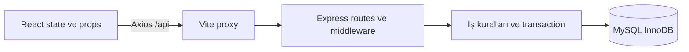

# SmartRent — Car Rental Management System

React + Vite, Axios, Node.js + Express, MySQL ve Docker Compose tabanlı araç kiralama projesi.

## Kurulum ve çalıştırma

Node.js 24 ve Docker Desktop (Linux containers) kullanılır. Paketlerin kesin sürümleri client/package-lock.json ve server/package-lock.json dosyalarında kilitlidir.

Yeni bir checkout için PowerShell komutları:

```powershell
Copy-Item .env.example .env
# .env içindeki iki örnek veritabanı parolasını değiştir.
docker compose up --build -d --wait
```

Mevcut çalışma klasöründe .env benzersiz yerel parolalarla oluşturuldu; tekrar kopyalama. .env Git dışında tutulur.

- Uygulama: http://localhost:5173
- API sağlık kontrolü: http://localhost:3000/api/health
- MySQL: 127.0.0.1:3307 (kullanıcı ve veritabanı varsayılanı: smartrent)
- Portlar: .env içindeki CLIENT_PORT, SERVER_PORT, DB_PORT.
- Durum/loglar: `docker compose ps`, `docker compose logs --tail 50`.
- Durdurma: `docker compose stop`; tekrar açma: `docker compose start`.
- Kod değişikliği sonrası konteynerleri güncelleme: `docker compose up --build -d --wait`.

Bu Compose yapılandırması geliştirme içindir; Vite geliştirme sunucusu kullanır. Veritabanı mysql_data isimli kalıcı volume üzerinde tutulur. `docker compose down` volume'u korur; `down -v` verileri siler ve normal kullanım komutu değildir.

İlk boş volume açılışında database/init/001-bootstrap.sql uygulanır. Mevcut volume üzerinde başlangıç SQL'i tekrar çalışmaz. Faz 2'de şema değişiklikleri için ileri yönlü migration yolu eklenecek; SQL değişikliği uygulamak için volume silinmeyecek. Bu aşamada iş tabloları ve demo hesapları yoktur.

## Yerel geliştirme

```powershell
npm ci --prefix client
npm ci --prefix server
docker compose up -d db
```

İki ayrı terminalde:

```powershell
npm run dev --prefix server
npm run dev --prefix client
```

Önce Compose client/server servisleri çalışıyorsa `docker compose stop client server` ile portlarını serbest bırak. Yerel API .env dosyasını okur ve DB_PORT üzerinden MySQL'e bağlanır. Vite /api isteklerini localhost:3000'e iletir. SERVER_PORT farklıysa istemci terminalinde `$env:API_PROXY_TARGET='http://localhost:YENI_PORT'` ayarla. Yerel istemci portu için `npm run dev --prefix client -- --port YENI_PORT` kullan; doğrudan çapraz-origin API erişimi gerekiyorsa sunucuda CLIENT_ORIGIN de aynı origin olmalı.

```powershell
npm test --prefix server
npm run build --prefix client
```

## Mimari ve kapsam

client/ React arayüzü, server/ Express API ve database/ SQL altyapısıdır. Tarayıcı Axios ile aynı origin üzerindeki /api yolunu çağırır; Docker içinde Vite proxy server:3000'e, API ise db:3306'ya bağlanır. /api/health gerçek SELECT 1 sorgusuyla bağlantıyı doğrular; hata durumunda 503 döner. Sunucu testleri ayrıca bu başarısızlık davranışını taklit edilmiş DB ile kontrol eder.

Kullanıcı isteğiyle docs/ klasörü kaldırıldı; proje notları README'de tutulur. Ders slaytları erişilebilir değil, kapsam roadmap'e dayanır. Faz 0 tasarım kararlarının özeti: günlük kiralama, Europe/Istanbul iş tarihi, başlangıç dahil/bitiş hariç aralıklar, TRY fiyatı ve rezervasyon anındaki fiyatın saklanması; pending/confirmed çakışmaları engeller. Pending kayıtların otomatik süresi dolmaz; eski ödenmemiş kayıtları admin iptal edebilir. Gerçek kart/ödeme alınmaz. Tamamlanmış ve ödenmiş kiralamaya her 100 TRY için bir puan, tam iadede bir kez ters kayıt planlanır. Yetkiler sunucuda uygulanır; müşteri yalnızca kendi kayıtlarını, admin yönetim kayıtlarını görür. Oturumlar sunucu tarafında saklanacak. İşlem kilidi sırası araç, rezervasyon, ödeme ve puan kaydı olacak; eşzamanlılık garantisi ancak Faz 5'te gerçek MySQL testinden sonra verilecek.

Şu an yalnızca geliştirme altyapısı ve başlangıç ekranı var. Katalog, hesaplar, rezervasyon, ödeme ve admin özellikleri sonraki fazlardadır. Yenilenen Faz 0 sözleşmesi aşağıdadır; docs/ klasörü kullanılmaz.

## Faz 0 — Güncel proje sözleşmesi

2026-11-03 tarihinde mevcut Faz 1 altyapısı üzerinden yeniden hazırlanmıştır. Bu bölüm gelecek fazların tasarım sözleşmesidir; iş özelliklerinin uygulanmış olduğu anlamına gelmez. Uygulama adı **SmartRent**, API öneki **/api**. Faz 0 yeniden çalışması yalnızca README ve roadmap belgelerini kapsar; yeni paket, uygulama kodu, şema değişikliği veya veri taşıma içermez.

### Depo incelemesi ve sınırlar

| İncelenen alan | Mevcut durum | Sonraki iş |
|---|---|---|
| client/ | React 19.3.1, Vite 8.3.5, Axios 1.21.0; sağlık durumunu gösteren ekran | P2 katalog ve bileşenler |
| server/ | Express 5.3.0, mysql2 3.24.6, cors 2.8.6; /api/health ve JSON hata yanıtları | P2 katalog API'si; P3 kimlik/yetki |
| database/ | İlk kurulum SQL'i, yalnızca schema_version tablosu | P2 migration yolu ve iş şeması |
| Testler | server/test/health.test.js: sağlıklı DB, başarısız DB, 404; DB taklit edilir | İlgili fazlarda gerçek MySQL entegrasyonu |
| Compose | client/server/db, MySQL 8.4, kalıcı volume, sağlık kontrolleri | Mevcut altyapıyı koru |
| Bağımlılıklar | Ayrı package.json ve lockfile'lar; Node 24 hedefi | Gerekçesiz yükseltme yapma |
| Kaynak gereksinimler | Roadmap mevcut; ders slaytları paylaşılabilir değil | Slayt uyumu doğrulandı iddiasında bulunma |

JavaScript ES modules kullanılacak. Araç satırı tek fiziksel aracı temsil eder. Gerçek ödeme, kart bilgisi, kısmi iade, puan harcama, çok şubeli envanter ve rol yönetimi kapsam dışıdır. Ayrı bir smartrent/ alt klasörü açılmaz; mevcut depo kökü kullanılır.

### Mimari, adlandırma ve API kuralları



Vite proxy mevcut geliştirme yoludur. Routes/controllers girdiyi doğrular, services iş kurallarını ve transaction'ları yönetir, veritabanı sorguları parametreli çalışır. React doğrudan DOM değiştirerek veri göstermeyecek. İstemci fiyatı yalnızca biçimlendirir; asıl hesaplama sunucudadır.

JSON ve JavaScript camelCase, SQL snake_case, React bileşenleri PascalCase, kaynak URL'leri çoğul olacak. Kimlikler pozitif tamsayı; tarih YYYY-MM-DD, zaman damgası UTC ISO 8601. Yazma isteklerinde tanımsız alanlar reddedilir. Hatalar { error: { code, message, fields? } } biçiminde; 400 geçersiz girdi, 401 oturumsuz, 403 rol yasağı, 404 bulunamayan veya başkasına ait özel kayıt, 409 iş kuralı/benzersizlik çakışması. Sağlık kontrolünün mevcut yanıtı bu genel hata zarfından ayrıdır.

Liste uçlarında page/pageSize (varsayılan 20, en fazla 100), kararlı sıralama ve { items, page, pageSize, total } kullanılacak. Sıralama alanları izin listesiyle seçilecek; kullanıcı girdisi SQL tanımlayıcısına doğrudan eklenmeyecek. /cars/alternatives gibi sabit yollar /cars/:id öncesinde tanımlanacak. Kısmi güncellemelerde PATCH seçildi; PUT zorunlu değil.

### Gereksinim matrisi

Aşağıdaki bütün yollar /api öneki taşır. T01–T15 tanımları test planında yer alır. P2–P8 satırları henüz uygulanmamıştır.

| ID | Gereksinim | Ekran | API metodu ve yolu | Tablo | Test | Faz |
|---|---|---|---|---|---|---|
| R01 | Katalog, fiyat, arama/filtre/sıralama, detay | Home, Catalog, CarDetails | GET /cars, /cars/:id | cars | T01 | P2 |
| R02 | Kayıt, giriş, çıkış | Register, Login | POST /auth/register, /auth/login, /auth/logout | users, sessions | T02 | P3 |
| R03 | Profil ve sahiplik/rol güvenliği | Profile, korunan sayfalar | GET/PATCH /me; tüm korunan yollar | users, sessions | T03 | P3+ |
| R04 | Tarihe göre müsaitlik | CarDetails, tarih seçimi | GET /cars/:id/availability | cars, reservations | T04 | P4 |
| R05 | Aynı tarihlerde uygun alternatifler | CarDetails, çakışma görünümü | GET /cars/alternatives; POST /reservations çakışma yanıtı | cars, reservations | T05 | P4/P5 |
| R06 | Rezervasyon, fiyat hesabı, çifte rezervasyon engeli | Booking, Confirmation | POST /reservations | cars, reservations | T06 | P5 |
| R07 | Kendi kiralama geçmişi ve iptal | MyBookings | GET /reservations/mine; PATCH /reservations/:id/cancel | reservations, payments, loyalty_transactions | T07 | P5/P6 |
| R08 | Ödeme simülasyonu ve geçmişi | Payments, MyBookings | POST /payments/simulate; GET /payments/mine | reservations, payments | T08 | P6 |
| R09 | Puan bakiyesi, hareketler ve geri alma | Loyalty | GET /loyalty/mine; admin tamamlama/iade yolları | reservations, payments, loyalty_transactions | T09 | P6 |
| R10 | Araç CRUD, fiyat ve bakım yönetimi | Admin cars | GET/POST /admin/cars; PATCH/DELETE /admin/cars/:id | cars, reservations | T10 | P7 |
| R11 | Tüm rezervasyonları yönetme | Admin bookings | GET /admin/reservations; PATCH /admin/reservations/:id; POST /admin/reservations/:id/refund | reservations, payments, loyalty_transactions | T11 | P6/P7 |
| R12 | Müşteri arama/görme/düzenleme | Admin customers | GET /admin/customers, /admin/customers/:id; PATCH /admin/customers/:id | users | T12 | P7 |
| R13 | Ödeme kayıtlarını inceleme | Admin payments | GET /admin/payments | payments, reservations, users | T13 | P7 |
| R14 | Tekrarlanabilir kurulum, veri kalıcılığı | Başlangıç ekranı, README | GET /health | schema_version, uygulama tabloları | T14 | P1/P2 |
| R15 | Responsive, erişilebilirlik, hata/boş durumlar ve demo | Tüm ekranlar, README | Tüm ilgili yollar | Tüm uygulama tabloları | T15 | P8 |

### Yetki matrisi ve oturum kararı

| İşlem | Misafir | Müşteri | Admin |
|---|---|---|---|
| Katalog, detay, müsaitlik, alternatifler | Evet | Evet | Evet |
| Kendi profilini görme/düzenleme, çıkış | Hayır | Kendi | Kendi |
| Rezervasyon oluşturma ve ödeme simülasyonu | Hayır | Kendi | Müşteri akışı yok |
| Kişisel rezervasyon/ödeme/puan geçmişi | Hayır | Kendi | Yönetim ekranlarından |
| Rezervasyon iptali | Hayır | Kendi, başlangıçtan önce | Confirmed başlangıçtan önce; ödenmemiş pending her zaman |
| Tamamlama ve tamamlanmış kiralamayı iade | Hayır | Hayır | Yaşam döngüsü koşullarıyla |
| Araç/fiyat/bakım, tüm rezervasyon ve ödemeler | Hayır | Hayır | Evet |
| Müşteri profili arama/görme/güncelleme | Hayır | Hayır | Yalnız ad/e-posta güncelleme |

Kayıt daima customer rolü oluşturur. Profil güncellemesi yalnız name/email kabul eder; role, password_hash, userId, tutar, puan ve durum alanları toplu atamaya açık olmayacak. E-posta trim ve küçük harfe dönüştürülerek benzersiz tutulur. Yanıtlarda parola özeti ve session bilgisi bulunmaz. Ön yüz route guard'ları sunucu yetkisinin yerine geçmez.

P3'te MySQL üzerinde tutulan opak sunucu oturumu seçildi. Girişte session yenilenir, çıkışta geçersiz kılınır, süre 24 saattir. Cookie HttpOnly, SameSite=Lax ve HTTPS'te Secure olacak; yerel HTTP geliştirme istisnadır. Oturum belirteci localStorage'da tutulmaz. Parolalar tuzlu güvenli hash ile saklanır; kütüphane P3'te seçilir. Yazma isteklerinde origin kontrolü ve oturumlu isteklerde CSRF belirteci; girişte hız sınırı uygulanır. GET /me, sayfa yenilendiğinde güvenli profil ve CSRF belirtecini sağlayabilir. Mevcut Faz 1 CORS ayarı P3'te cookie/credentials gereksinimine göre güncellenecek.

### Tarih, fiyat ve müsaitlik kararı

İş tarihi Europe/Istanbul'a göredir. Tarihler gerçek takvim günü olmalı; yeni rezervasyonda start >= bugün ve end > start. Başlangıç dahil, bitiş hariç; minimum bir gün. Süre takvim günü farkıdır, tarayıcının saat farkı değildir. Testler sabit saat kullanır.

Para birimi TRY; veritabanında DECIMAL(12,2), hesaplamada tam sayı kuruş, JSON'da ondalık metin kullanılır. Toplam = gün sayısı × rezervasyon anındaki günlük fiyat. daily_price_snapshot ve total_price saklanır; daha sonraki fiyat değişikliği geçmiş tutarı değiştirmez. Vergi, depozito ve ek ücret yoktur; alan taşması reddedilir. Müşteri fiyat veya sahiplik belirleyemez.

Yalnız active araç yeni rezervasyon alır. Pending ve confirmed kayıtlar `existing.start_date < requested.end_date AND existing.end_date > requested.start_date` koşuluyla tarihleri bloke eder. Cancelled/completed bloke etmez. Bitişi yeni başlangıca eşit rezervasyon uygundur. Pending otomatik sona ermez; ödeme veya iptale kadar envanteri tutar. Müşteri başlangıçtan önce, admin eski ödenmemiş pending kayıtları da iptal edebilir. Bu sınırlama rezervasyon ekranında açıklanacak.

Alternatifler aynı tarih aralığında uygun, active ve istenen araçtan farklı olmalı; varsa minimum koltuk filtresi uygulanır. Sıra: aynı kategori, mutlak günlük fiyat farkı, koltuk farkı, aynı vites, araç ID. En fazla beş sonuç ve sıralama nedenleri; yoksa boş liste. GET müsaitliği bilgilendiricidir; POST rezervasyon transaction içinde yeniden doğrular.

### Rezervasyon, ödeme ve puan yaşam döngüsü

| Geçiş | Tetikleyen | Koşul ve atomik etki |
|---|---|---|
| Yeni → pending | Müşteri | Tarih/araç/çakışma kontrolü; fiyat anlık görüntüsü |
| pending → confirmed | Sahibi, başarılı simüle ödeme | Başlangıç geçmişte değil; ödeme paid aynı transaction'da |
| pending → pending | Sahibi, başarısız ödeme | Ödeme failed; envanter blokajı devam, tekrar deneme mümkün |
| pending → cancelled | Sahibi/admin | Sahibi başlangıçtan önce; admin eski ödenmemiş kaydı da iptal edebilir |
| confirmed → cancelled | Sahibi/admin | Başlangıçtan önce; tam simüle iade |
| confirmed → completed | Admin | Bugün >= bitiş; ödeme paid; puan aynı transaction'da |
| completed → completed | Admin iadesi | Ödeme refunded; varsa puan kazanımı bir kez ters çevrilir |

Cancelled terminaldir; completed yeniden açılamaz. Tarih/araç değişikliği iptal + yeni rezervasyonla yapılır. Başladıktan sonra confirmed iptali yoktur. Tamamlama zamanla otomatik gerçekleşmez, admin eylemidir. Completed iadesi kiralama durumunu değiştirmez; ödeme refunded olarak görünür.

Her rezervasyon için tek ödeme özet kaydı: UNIQUE(reservation_id). pending → paid/failed; failed → pending → paid/failed yeniden denemesi; paid → refunded. İade sonrası tekrar ödeme ve paid → failed geçişi yasak. POST /payments/simulate yalnız reservationId ve success/failure sonucu alır, tutar/kart almaz. Ödeme tutarı rezervasyon toplamıdır. Paid isteğinin tekrarı mevcut sonucu döndürür, refunded kayda ödeme 409 döndürür. Ayrı ödeme deneme geçmişi kapsam dışıdır.

Puan yalnız completed ve paid olduğunda `floor(total_kurus / 10000)` olarak bir kez kazanılır. Sıfır puan için de award kaydı tutulur. Bakiye SUM(points_delta); UNIQUE(reservation_id, reason) ile award/reversal tekrarı önlenir. İade, ilk award değerinin negatifini bir kez yazar; güncel fiyatla hesaplanmaz. Puan yazan müşteri API'si olmayacak. Tekrar tamamlama/iade mevcut sonucu döndürür.

### Veri modeli ve eşzamanlılık tasarımı

| Tablo | Planlanan temel alan ve kısıtlar |
|---|---|
| users | id, name, email UNIQUE, password_hash, role, created_at |
| sessions | Oturum kimliği, oturum verisi, expires_at; P3 adaptörüne göre |
| cars | id, vehicle_code UNIQUE, brand/model/category, seats, transmission, fuel_type, daily_price, image_url, status active/maintenance/inactive |
| reservations | id, user_id FK, car_id FK, start_date/end_date DATE, daily_price_snapshot, total_price, currency, status, created_at |
| payments | id, reservation_id UNIQUE FK, amount, currency, status, method_label simulated, paid_at, refunded_at |
| loyalty_transactions | id, user_id FK, reservation_id FK, points_delta, reason, created_at; UNIQUE(reservation_id, reason) |
| schema_version | Mevcut bootstrap sürümü; P2 migration geçmişi için genişletilecek |

Rezervasyon indeksleri (car_id, status, start_date, end_date) ve (user_id, created_at). FK'lar geçmiş kayıtların silinmesini engeller; cascade ile ödeme/puan geçmişi silinmez. Tarih sırası, pozitif koltuk, negatif olmayan fiyat ve durumlar servis ve uygun DB kısıtlarıyla doğrulanır. locations ertelendi.

P5'te tüm envanter yazıcıları aynı kilit sırasını kullanacak: araç SELECT FOR UPDATE → varsa rezervasyon → ödeme → puan. Tek bağlantıda transaction, READ COMMITTED ve araç kilidinden sonra güncel çakışma sorgusu. Boş rezervasyon aralığında dahi araç satırı kilitlenir. car_id değişmez; mevcut rezervasyon işlemlerinde araç kimliği kilit altında yeniden doğrulanır. Hata halinde tüm işlem rollback; çakışmada 409 ve transaction sonrasında taze alternatifler. Deadlock/timeout kısmi başarı döndürmez; yeniden denenebilir hata olarak bildirilir.

Admin araç durum değişikliği de araç kilidini alır. Pending/confirmed rezervasyon varsa bakım veya pasifleştirme 409 döndürür. DELETE fiziksel silmek yerine inactive yapar. Fiyat düzenlemesi yalnız yeni rezervasyonları etkiler. Gerçek MySQL eşzamanlılık testi geçmeden çifte rezervasyon önlendi iddiası yapılmayacak.

P2'de ileri yönlü numaralı migration'lar ve sürüm kaydı mevcut bootstrap ile uyumlu hale getirilecek; mevcut volume silinmeyecek. Şema altyapısı P4 müsaitlik testlerine rezervasyon fixture'ı sağlayacak; P5 öncesi rezervasyon API'si yazılmayacak. P6 puan akışını test etmek için admin korumalı tamamlama/iade API'si ekleyecek; yönetim arayüzü P7'de gelecek. Tamamlama PATCH /admin/reservations/:id (status=completed), iade POST /admin/reservations/:id/refund; admin müşteri detayı GET /admin/customers/:id.

### Minimal demo veri planı

Bu tablo seed değildir; fiyat ve özellikler kurmaca demo verileridir. Görseller yerel placeholder veya lisanslı varlıklardan seçilecek.

| Araç kodu | Model | Kategori | Koltuk | Vites | Yakıt | Günlük TRY | Durum |
|---|---|---|---|---|---|---|---|
| DEMO-01 | Renault Clio | economy | 5 | manual | petrol | 1000.00 | active |
| DEMO-02 | Fiat Egea | economy | 5 | manual | diesel | 1100.00 | active |
| DEMO-03 | Toyota Yaris | economy | 5 | automatic | hybrid | 1250.00 | active |
| DEMO-04 | Toyota Corolla | sedan | 5 | automatic | hybrid | 1500.00 | active |
| DEMO-05 | Honda Civic | sedan | 5 | automatic | petrol | 1600.00 | active |
| DEMO-06 | Skoda Octavia | sedan | 5 | automatic | diesel | 1700.00 | active |
| DEMO-07 | Dacia Duster | suv | 5 | manual | diesel | 1800.00 | active |
| DEMO-08 | Nissan Qashqai | suv | 5 | automatic | petrol | 2000.00 | active |
| DEMO-09 | Peugeot 5008 | suv | 7 | automatic | diesel | 2400.00 | active |
| DEMO-10 | Volkswagen Transporter | van | 9 | manual | diesel | 2600.00 | active |
| DEMO-11 | BMW 320i | premium | 5 | automatic | petrol | 3500.00 | maintenance |
| DEMO-12 | Mercedes C200 | premium | 5 | automatic | petrol | 3600.00 | inactive |

Planlanan hesaplar: admin@smartrent.example, customer.a@smartrent.example, customer.b@smartrent.example. Parolalar yerel ortamdan alınır ve hash'lenir; repoya parola veya yetki atlatma kodu eklenmez. Seed yalnız development/test modunda, tekrar çalıştırılabilir olacak.

D, seed'in açıkça çalıştırıldığı iş günüdür; uygulama her açıldığında mevcut tarihler kaydırılmaz. A müşterisi için DEMO-01 [D+7,D+10) confirmed/paid; B için DEMO-04 aynı aralıkta pending; A için DEMO-05 aynı aralıkta cancelled. Böylece çakışma, alternatif ve iptal sonrası müsaitlik gösterilir. A için DEMO-06 [D-10,D-7) completed/paid: 5100 TRY, +51 puan. B için DEMO-08 [D-8,D-6) completed/refunded: 4000 TRY, +40/-40 puan. Geçmiş tarihler test/seed yordamıyla oluşturulur; normal API tarih doğrulaması gevşetilmez.

P2 araçları, P3 kullanıcıları, P6 ödeme/puan demolarını ekler. P4 doğrudan test verisi kullanır. Hiçbiri bu Faz 0 çalışmasında oluşturulmaz.

### Test planı ve faz kapıları

Aşağıdaki ürün testleri planlanmıştır. T01–T13 ve T15 çalıştırılmadı; T14'ün P1 kapsamı önceki doğrulama kaydında geçti, P2 migration kontrolleri bekliyor.

| ID | Kabul kontrolü ve beklenen sonuç | Yöntem |
|---|---|---|
| T01 | MySQL katalog; birleşik filtre/sıralama/sayfalama; detay; yanlış ID 400/404; yükleniyor/hata/boş UI | API + UI |
| T02 | Kayıt/giriş/çıkış; normalleştirilmiş e-posta benzersizliği; hash; session yenileme/süre/iptal; hız sınırı | API + DB |
| T03 | Oturumsuz 401; admin rolü 403; A'nın B verisine erişimi 404; alan atama ve CSRF/origin engeli; güvenli profil yanıtı | Her korunan API |
| T04 | Aynı/kısmi/içeren/içerilen aralık bloke; bitiş-başlangıç komşuluğu serbest; iptal/tamamlanmış bloklamaz; bakım/pasif ve geçersiz/geçmiş tarih | Birim + MySQL |
| T05 | Alternatiflerin tamamı tam istenen aralıkta uygun; araç hariç; koltuk filtresi; kararlı sıralama; boş liste; POST çakışma yanıtı | API + MySQL |
| T06 | Fiyat manipülasyonu engeli; snapshot ve kuruş/gün sınırları; iki eşzamanlı çakışan istekte tek 201/tek 409/tek DB kaydı; ayrık tarihlerde iki başarı; rollback | Birim + gerçek MySQL |
| T07 | Yalnız kendi geçmişi; uygun iptal ve iade; başlamış confirmed iptali ret; eski unpaid pending admin iptali; terminal geçiş reddi; tarihlerin boşalması | API + DB |
| T08 | Ödeme başarısızlık/tekrar/başarı; eşzamanlı tekrarlar tek ödeme; ödeme-iptal yarışı tutarlı; kart/tutar müdahalesi yok; sahiplik | API + gerçek MySQL |
| T09 | Completed+paid öncesi puan yok; 99.99 TRY=0, 100 TRY=1; tekrar/eşzamanlı tamamlama tek award; iade tek reversal; bakiye toplamı; zorlanmış hatada rollback | Birim + gerçek MySQL |
| T10 | Admin CRUD/fiyat/bakım; müşteri yasağı; aktif rezervasyonlu araç pasifleştirilemez; rezervasyon-durum değişikliği yarışı; geçmiş korunur | API + gerçek MySQL |
| T11 | Admin liste/filtre; erken/ödenmemiş tamamlama ret; zamanında tek award; araç/tarih değişmez; tamamlanmış iade; tamamlama-iade yarışı | API + gerçek MySQL |
| T12 | Müşteri arama/detay/ad/e-posta; duplicate ret; rol/parola/puan değişikliği ret; admin kaydı müşteri listesinde yok | API |
| T13 | Admin ödeme listesi/filtre; paid/refunded doğru; müşteri erişemez; gizli alan yok | API |
| T14 | Temiz Compose başlangıcı, health 200/503, proxy, volume kalıcılığı; P2 migration tekrarı güvenli; sırlar Git dışında | Docker + DB |
| T15 | Misafir → kayıt → alternatif → rezervasyon → ödeme → admin tamamlama → geçmiş/puan → iade; klavye/etiket/responsive; yeni checkout README kurulumu | Tarayıcı + manuel inceleme |

Entegrasyon testleri ayrı test MySQL'inde aynı migration'larla çalışır; geliştirme veritabanı temizlenmez. Eşzamanlı testler ayrı bağlantılar ve eşgüdümlü başlangıç kullanır; ardışık istek/mock sonuçları kilit kanıtı değildir. Yanıtlarla birlikte DB kayıt sayısı ve tutarlılığı doğrulanır. Saat sabitlenir; testler arası fixture'lar sıfırlanır. Her fazda komut, sonuç ve kalan risk kaydedilir; Docker yoksa test engelli sayılır. Ders slaytları olmadan slayt denetimi geçti denmez.

### Faz 0 kabul kaydı

Yeniden incelemede git durumu, dosya listesi, package/lockfile'lar, Compose, başlangıç SQL'i, API/istemci ve mevcut sağlık testleri esas alındı. Kabul koşulları: 15 gereksinimin ekran–API–tablo–test eşlemesi; isim/stack/adlandırma; yetki matrisi; tarih/fiyat/rezervasyon/ödeme/puan kuralları; 12 araç ve 3 hesaplık demo planı; faz bağımlılıkları ve test beklentileri.

**Sonuç: Faz 0 kabulü geçti.** Roadmap gereksinimlerine karşı manuel kapsam incelemesi ve Node.js ile belge/lockfile kontrolü yapıldı: 15 eksiksiz gereksinim satırı ve test karşılığı, 10 sözleşme alt bölümü, 12 araç, 3 hesap, kesin bağımlılık sürümleri, iki roadmap kopyası ve ilerleme listeleri doğrulandı; docs/ bulunmuyor. `git diff --check` geçti. İlk doğrulama denemelerindeki PowerShell JSON/standart girdi kodlama sorunu Node.js kontrolüyle giderildi; başarılı sonuç son çalıştırmaya aittir.

Faz 1'in önceki başarılı test kaydı korunur; Faz 0 yeniden planlaması bu testlerin yeniden çalıştırıldığı anlamına gelmez. Uygulama ve veritabanı bu çalışmada değiştirilmedi. Kalan sınırlar: ders slaytları doğrulanamıyor; pending kayıtlar otomatik sona ermiyor; ürün testleri ilgili fazlarda çalıştırılacak. Sonraki uygulama fazı P2'dir. Bu belge güncellemeleri henüz commit/push yapılmadı.

## Doğrulama durumu

Faz 1 kontrolleri 2026-11-03 tarihinde geçti:

- `npm test --prefix server`: 3/3 test başarılı (sağlıklı DB, DB hatasında 503, bilinmeyen rota).
- `npm run build --prefix client`: başarılı.
- `docker compose config --quiet` ve `docker compose up --build -d --wait`: başarılı; üç servis healthy.
- API ve Vite proxy üzerinden /api/health: 200, database connected.
- `docker compose up -d --force-recreate --wait`: SQL test kaydı korundu; kontrolden sonra yalnızca test kaydı silindi.
- Playwright + kurulu Edge: http://localhost:5173 açıldı ve “Geliştirme ortamı hazır.” metni doğrulandı.
- .env, node_modules, dist ve log dosyaları Git dışında; docs/ kaldırıldı.

Kurulu paketler: React/React DOM 19.3.1, Vite 8.3.5, Axios 1.21.0, Express 5.3.0, mysql2 3.24.6, cors 2.8.6. Docker MySQL 8.4 kullanır. Node.js 24.21.0, npm 11.19.0 ve Docker Desktop bilgisayarda zaten kurulu olduğundan yeniden kurulmadı. Node/MySQL Docker etiketleri aynı ana sürümde yeni yamaları alabilir; npm paketleri kesin sürüm ve lockfile ile kilitli.

Faz 2 ve sonraki ürün davranışları henüz uygulanmadı/test edilmedi. Kurulum yereldir; bu değişiklikler henüz GitHub'a pushlanmadı.

Kurulum referansları: [Vite](https://vite.dev/guide/), [Express](https://expressjs.com/en/starter/installing/).

## Roadmap

Aşağıdaki planın ayrı kopyası SMARTRENT_AGENT_ROADMAP.md dosyasında tutulur. İlerleme listeleri birlikte güncellenir.

---

# SmartRent — Agent-Ready Development Roadmap

## 0. Project contract

Build **Car Rental Management System** using React, Node.js + Express, MySQL, Axios, and Docker Compose. The application must support: car catalog with prices and availability, date-based bookings, alternative cars when unavailable, customer accounts and profiles, rental history, payment tracking, loyalty points, and an admin panel for cars, bookings, pricing and customer profiles.

**Source alignment:** Course slides are unavailable; exact slide alignment is unverified. The roadmap targets JS/ES6, React JSX/components/props/state/events/hooks, Axios, Node.js, Express, MySQL and CRUD. Authentication, payment tracking, booking conflict prevention, robust authorization, Docker and loyalty points are product requirements/engineering extensions, *not direct prescriptions from course slides*.

### Non-negotiable engineering rules
1. Work in small, reviewable phases. Never implement future phases before acceptance checks for current phase pass.
2. Inspect existing repository before changing anything. Never overwrite working code blindly.
3. Keep frontend, backend, database separate. Use React state/props to render UI, not direct DOM mutation.
4. Use JavaScript with ES modules unless repository already chooses otherwise; prefer readable, course-aligned code to excessive abstractions.
5. Use parameterized queries and database transactions; no string-concatenated SQL.
6. All privileged APIs enforce authorization on the server. Passwords must be hashed, never stored in plaintext.
7. No real credit card handling: simulate payments using statuses and records; document that this is not a production payment gateway.
8. Availability is **date-range derived**, not a global `available` flag. A maintenance/active status may be stored separately.
9. Prevent double-booking under concurrent requests using an appropriate transaction/locking strategy, not only frontend checks.
10. Never commit real `.env`, secrets, database data, or `node_modules`; commit `.env.example`.
11. Use Docker Compose for `client`, `server`, and `db`; persistent named volume for MySQL. The browser calls exposed API URL, backend calls Docker host `db`.
12. Each phase ends with tests, updated README, and a short summary of changes, commands executed, remaining risks.
13. Do not mark a requirement complete without running its acceptance test. Ask the user before irreversible destructive migrations or broad scope changes.

## 1. Required user roles and flows

- **Guest:** Browse catalog, search and filter cars, check availability. Must authenticate before booking.
- **Customer:** Register, log in/out, edit profile, select rental dates, book available car, see alternatives when chosen car is unavailable, view own bookings/history, simulate payment, view payments and loyalty balance/history, cancel eligible booking.
- **Admin:** Log in, manage cars and prices, mark cars active/in maintenance, view/manage all bookings, view/manage customer profiles according to role, review payment records. Restrict all admin APIs.

### Core booking lifecycle
1. Customer chooses car and pickup/return dates.
2. Backend validates valid date interval, car active, capacity and availability.
3. If unavailable, API returns alternative *available* cars for the same date range (nearest category/price/attributes); frontend shows alternatives and reasons.
4. If available, backend creates pending reservation atomically and returns server-calculated total.
5. A simulated payment sets payment and reservation statuses consistently inside a transaction.
6. Loyalty points are awarded once per eligible completed-and-paid reservation (choose and document exact award rule) and reversed on refund/cancellation where applicable.

## 2. Technology and repository layout

```text
smartrent/
  client/
    src/
      components/{layout,cars,booking,forms,common}/
      pages/{Home,Catalog,CarDetails,Login,Register,Profile,MyBookings,Payments,Loyalty,Admin}/
      hooks/
      context/
      services/api.js
      utils/{pricing,recommendations,dates}.js
      App.jsx
    Dockerfile
    package.json
  server/
    src/
      app.js
      index.js
      config/db.js
      routes/
      controllers/
      services/
      middleware/{auth,errorHandler,validate}.js
    Dockerfile
    package.json
  database/
    migrations/
    seed.sql
  compose.yaml
  .env.example
  README.md
  # Architecture, API and test notes are maintained in README.md.
```

Recommended core tables (adapt migration details to agreed lifecycle):
- `users(id, name, email UNIQUE, password_hash, role, created_at, ...)`
- `cars(id, brand, model, category, seats, transmission, fuel_type, daily_price, image_url, status, ...)`
- `reservations(id, user_id FK, car_id FK, start_date, end_date, total_price, status, created_at, ...)`
- `payments(id, reservation_id FK, amount, status, method_label, paid_at, ...)` — simulated records, no card credentials
- `loyalty_transactions(id, user_id FK, reservation_id FK, points_delta, reason, created_at, ...)`
- `locations(id, city, address, ...)` optional if location filter is needed.

Use consistent **start inclusive, end exclusive** date ranges and document timezone/day pricing assumptions. Reservation overlap: `existing.start_date < requested.end_date AND existing.end_date > requested.start_date` for blocking statuses. Status transition and concurrency rules must be explicit.

## 3. Phased implementation plan

### Phase 0 — Repository inspection, scope, conventions
**Agent tasks:** Inspect files, package versions, existing slides/requirements and tests. Prepare requirements matrix and architecture notes. Pick application name, API prefix `/api`, naming conventions, reservation/payment/points lifecycles, permissions matrix, and a minimal demo dataset. Maintain architecture, test-plan notes and progress in README.md; do not prematurely code features.

**Exit criteria:** All mandatory project requirements are mapped to screens, API routes, tables and tests. Assumptions (simulated payments, points award rules, booking cancellation) documented.

**Current planning contract:** See the README section "Faz 0 — Güncel proje sözleşmesi" for the refreshed requirements matrix, architecture, lifecycle decisions, permissions, demo dataset and test plan. Keep these notes in README; do not recreate docs/. Existing Phase 1 infrastructure is retained.

### Phase 1 — Docker Compose and skeleton
**Agent tasks:** Bootstrap Vite React client, Express server, MySQL service, compose file, Dockerfiles, `.dockerignore`, `.gitignore`, `.env.example`, database volume and healthcheck, server health endpoint `/api/health`. Configure CORS for development and Vite API URL/proxy correctly. SQL initialization or migrations as one documented path. Confirm ports are configurable.

**Exit criteria:** `docker compose up --build` starts all services, `/api/health` returns success, frontend loads, MySQL data survives container recreation. Clean setup documented. If Docker host is unavailable, clearly report blocker rather than claiming tests passed.

### Phase 2 — Schema, seed and read-only car catalog
**Course topics:** JSX, components, props, `map()`, `filter()`, keys, conditional rendering, `useEffect`, Axios GET, Express GET and SQL SELECT.

**Agent tasks:** Create schema/migration and seed 10–15 representative cars. Build `Navbar`, `CarCard`, `CarGrid`, `CarFilters`, `CarDetails`; build GET `/api/cars`, GET `/api/cars/:id` with sorting/filters, optional paging. Fetch through Axios instance; render loading, errors and empty results. Use props and stable keys.

**Exit criteria:** Catalog data comes from MySQL, not hardcoded lists; model, daily price and attributes render; filters work; malformed/unknown IDs return appropriate errors; API tests pass.

### Phase 3 — User registration, login, profile and role security
**Course topics:** Forms, controlled inputs, event handlers, `useState`, `useContext`, Axios POST, Express routes.

**Agent tasks:** Signup/login/logout (session or secure token strategy documented), password hashing, input validation, unique emails, profile update, customer/admin role separation; frontend auth context, protected customer and admin pages; backend authentication/authorization middleware. No hardcoded admin bypass in production path; use documented development seed setup.

**Exit criteria:** Customer can register, log in/out, edit own profile; unauthenticated requests fail; customers cannot access admin routes or other customers' private records; password hash stored, not password.

### Phase 4 — Date-specific availability and alternatives
**Course topics:** Events, controlled dates, computed state, `filter()`, `map()`, Axios GET, SQL SELECT.

**Agent tasks:** Build date selection and validate `start < end` and no past dates if required; endpoint GET `/api/cars/:id/availability?startDate=...&endDate=...`, and GET `/api/cars/alternatives?carId=...&startDate=...&endDate=...`. Define blocking reservation statuses. Calculate alternatives on the server from available cars, sorted by category, price proximity, seats and transmission; explain ranking.

**Exit criteria:** Overlap scenarios correctly show unavailable; adjacent intervals are allowed under end-exclusive convention; alternatives all available for exactly requested dates; no fake recommendations if none exist.

### Phase 5 — Booking workflow and pricing
**Course topics:** State lifting, child-to-parent callbacks, controlled forms, conditional rendering, Axios POST, Express POST, MySQL INSERT, `async/await`.

**Agent tasks:** Reservation form, booking confirmation, server-side price calculation, customer ownership, booking listing and cancellation, booking statuses (`pending`, `confirmed`, `cancelled`, `completed`). Create a concurrency-safe booking transaction for simultaneous requests for the same car/time. Define expiry policy for pending bookings or ensure pending reservations intentionally block availability.

**Exit criteria:** A customer can complete reservation flow; price not trusted from client; overlap blocks a second simultaneous booking; own booking history works; unauthorized access fails; automated overlap and concurrency tests pass.

### Phase 6 — Simulated payments and loyalty ledger
**Course topics:** CRUD, POST/PATCH, state updates, MySQL transactions.

**Agent tasks:** `payments` API and UI with fake "pay now" action, payment states `pending/paid/failed/refunded`, no payment card collection; consistent reservation status on success. Implement points ledger with chosen formula (e.g. 1 point per 100 TRY of eligible completed paid rental), balance derived from transactions, exactly-once award idempotency, reversal on cancellation/refund where policy requires. Pages: payment history and loyalty balance/activity.

**Exit criteria:** Payment record tied to reservation; repeat payment or points request does not duplicate credit; history isolated per customer; refunded/cancelled bookings don't retain invalid points; test all transitions.

### Phase 7 — Admin dashboard and full CRUD
**Course topics:** `map()`, forms, props, Axios GET/POST/PUT/PATCH/DELETE, Express CRUD, SQL INSERT/UPDATE/DELETE, search.

**Agent tasks:** Admin CRUD for cars, price change, vehicle status and image URL; booking list and status management; customer profile search/view/edit of authorized fields; payment overview. Prefer soft-deactivation of cars with historical reservations. Add validation, confirmation for destructive actions, pagination/search if needed.

**Exit criteria:** All mandatory admin management functions work and persist; customers cannot access them; deleting/deactivating car does not corrupt past history; CRUD API tests pass.

### Phase 8 — Quality, course-concept audit, demo and delivery
**Course topics:** Events/hooks, derived state, JSX, Axios errors, Express/MySQL and CRUD reviewed end to end.

**Agent tasks:** Responsive styling; accessibility of forms and buttons; robust error boundaries/messages; route guards; reusable hooks such as `useCars` and `useReservations`; optional `useRef`, `useMemo`, `useCallback` only where useful. Audit important slide concepts against implemented examples, avoiding contrived extra code. Add seed demo accounts, API docs, architecture diagram, tests, complete README, quick demo steps, Docker instructions.

**Exit criteria:** Full end-to-end demo: guest browses → customer registers → checks dates → unavailable car gives alternatives → books → simulated payment → rental history / loyalty shows → admin manages cars, reservations, pricing and customer profiles. New teammate can set up from README.

## 4. Suggested API contract

| Method | Endpoint | Role | Purpose |
|---|---|---|---|
| GET | `/api/health` | public | service health |
| GET | `/api/cars` | public | catalog/filters |
| GET | `/api/cars/:id` | public | details |
| GET | `/api/cars/:id/availability` | public | date-specific availability |
| GET | `/api/cars/alternatives` | public | date-specific alternatives |
| POST | `/api/auth/register` | public | register |
| POST | `/api/auth/login` | public | login |
| POST | `/api/auth/logout` | authenticated | logout, depending on session implementation |
| GET/PATCH | `/api/me` | customer/admin | own profile |
| POST | `/api/reservations` | customer | new booking |
| GET | `/api/reservations/mine` | customer | own history |
| PATCH | `/api/reservations/:id/cancel` | owner/admin | cancel eligible booking |
| POST | `/api/payments/simulate` | owner | simulate payment |
| GET | `/api/payments/mine` | customer | payment history |
| GET | `/api/loyalty/mine` | customer | balance and ledger |
| GET/POST | `/api/admin/cars` | admin | list/create |
| PUT/PATCH/DELETE | `/api/admin/cars/:id` | admin | update/deactivate/remove |
| GET/PATCH | `/api/admin/reservations` and `/:id` | admin | manage bookings |
| GET/PATCH | `/api/admin/customers` and `/:id` | admin | manage profiles |
| GET | `/api/admin/payments` | admin | payment overview |

## 5. Test matrix (must automate where practical)

- Car catalog reads MySQL, handles no results and invalid IDs; search and filters combine correctly.
- Authentication: duplicate email, invalid input, wrong password, unauthenticated access, customer→admin escalation blocked, user A cannot access user B data.
- Availability: identical intervals overlap; partial overlap; containing interval; interval inside existing booking; adjacent non-overlap; cancelled bookings do not block.
- Booking: start/end validation, server-side price recalculation, unavailable returns alternatives, simultaneous requests cannot both book same car.
- Payments: duplicate simulated requests do not create inconsistent states; no sensitive card data stored.
- Loyalty: points earned once on eligible status, historical ledger correct, reversal/refund consistent.
- Admin: create/read/update/deactivate cars, update prices, manage bookings and permitted customer profile fields; authorization tests.
- Docker: fresh startup and data persistence across restart, secrets excluded from repo.

## 6. Agent execution prompt (copy into coding agent)

> You are the implementation agent for SmartRent. Read `SMARTRENT_AGENT_ROADMAP.md`, inspect the current repository, and implement **only the next incomplete phase**. Before coding, state which phase and requirements you are targeting, planned files, database changes, and acceptance checks. Follow the engineering rules and course stack strictly. Implement minimal coherent functionality, add tests, run them (including Docker if available), update README and progress tracking, and finish by reporting exactly which acceptance checks passed/failed with commands used. Do not fake test results, overwrite unrelated files, add real payment capture, skip server authorization, or claim a booking concurrency guarantee without a tested database strategy. Stop after completing the phase and await the next explicit task.

## 7. Delivery progress tracker

- [x] P0 Requirements and architecture documented
- [x] P1 Docker/dev environment operational
- [ ] P2 Catalog with real DB data
- [ ] P3 Accounts and secure roles
- [ ] P4 Availability and alternatives
- [ ] P5 Booking and concurrency safety
- [ ] P6 Simulated payments and loyalty
- [ ] P7 Admin management CRUD
- [ ] P8 Full tests and demo documentation

Update this checklist only when the corresponding phase's acceptance checks have actually passed.
